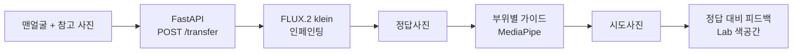
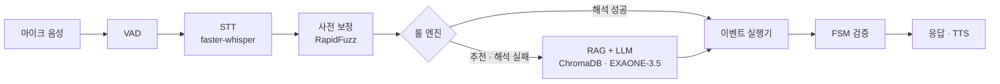
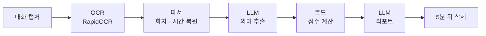

# 김덕현 · Deokhyeon Kim

**문제 해결을 위해 기술을 찾고 이유와 근거를 검증하는 AI 개발자 김덕현입니다**

 

 

## 🧭 이런 식으로 일합니다

- **문제에서 시작합니다** — 기술을 먼저 정하지 않고, 무엇이 왜 안 되는지부터 정의합니다. 결제 중 주문이 바뀌는 오류는 LLM 출력을 상태 기계(FSM)로 검증하는 구조로 풀었습니다.
- **이유가 있는 기술을 고릅니다** — 후보를 같은 기준으로 비교해, 왜 이 기술인지 설명할 수 있는 것을 씁니다. LLM 3종을 비교해 의도 분석 정확도 86.7%인 모델을 채택했습니다.
- **근거로 검증합니다** — 됐다고 말하기 전에 테스트와 실험 수치로 확인합니다. 판정 기준값은 반복 촬영으로 잰 흔들림 폭에서 정했습니다.

 

## 🚀 프로젝트

### 💄 nudy — 참고 사진의 화장을 내 얼굴에 옮겨 따라 하게 해 주는 화장 코치

`팀 6명` `통합 · 피드백 담당` `2026.09 ~ 2026.10` · [저장소](https://github.com/1DAN-2ZO/support-yr-makeup)

- **FLUX 이미지 생성 중계 API** — FastAPI · httpx로 GPU의 모델 서버를 호출하고, `asyncio.Lock`과 전체 시간 한도 85초로 요청 줄을 관리
- **정답사진 대비 피드백 엔진** — 얼굴 랜드마크로 부위별 구역을 만들고 Lab 색공간에서 변화량을 계산해 부위별 문장 생성
- **통합 · 리뷰** — CI와 강제 푸시 방지 훅을 구축하고 팀원 PR 195건을 로컬 검증 후 병합

    

 

### 🎙️ VINUS — 음성만으로 주문을 끝내는 시각장애인용 AI 음성 키오스크

`팀 5명` `팀장 · 백엔드 총괄` `2026.06 ~ 2026.08` · [백엔드](https://github.com/vinus-final-project/VINUS_backend) · [AI 서버](https://github.com/vinus-final-project/VINUS_ai) · [프론트](https://github.com/vinus-final-project/VINUS_frontend)

- **FSM 대화 상태 관리** — 상태 4개 · 이벤트 20개의 전이표와 검증기로 현재 상태에서 허용되지 않는 요청을 차단
- **룰 엔진 + LLM 이중 구조** — 대부분의 주문은 룰로 처리하고 자유로운 말만 LLM으로 전달 (평균 응답 514ms / LLM 경유 1,399ms)
- **LLM 출력 검증과 롤백** — LLM이 낸 이벤트를 전이표로 검증하고, 실패하면 세션 스냅샷으로 복원

      

 

### 💬 친구비 측정기 — 대화 캡처로 관계를 점수와 리포트로 보여 주는 웹 서비스

`개인` `2026.08` · [저장소](https://github.com/e9on/Friend-Cost)

- **LLM 2단계 파이프라인** — 점수는 코드가 계산하고 LLM은 의미만 읽게 해 같은 대화에 같은 점수가 나오도록 설계
- **구조화 출력 · 검증 · 재시도** — Pydantic 스키마를 프롬프트에 자동 삽입하고 응답을 검증
- **LLM 평가 하네스** — 순위 일치도 지표로 후보 4종을 비교 (채택 모델 93%, 합성 대화 6종 기준)

     

 

## 🛠️ 기술

| 분류 | 기술 |
|---|---|
| **AI · LLM** |      |
| **Backend** |       |
| **Frontend** |      |
| **DevOps · Tools** |      |

 

## 📫 연락

이메일 **e9on980@gmail.com**
